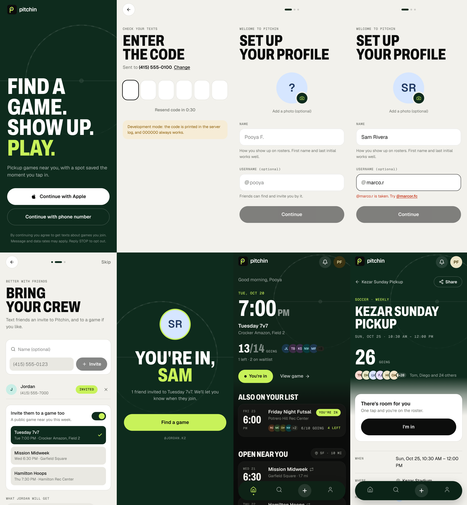

# Pitchin

Find a game. Show up. Play. Pickup games that run themselves. A weekly game posts itself before kickoff, the roster caps itself, and when someone drops out the next person on the waitlist gets a text.



## What it does

- **Groups and weekly games.** A group is a standing game, like "Tuesday 7v7". Organizers set the day, time, cap and minimum once. Each week's game is created ahead of time and opens for RSVPs on its own (48 hours before by default), and every member gets a text.
- **One-time games.** Anyone can post a single game, standalone or inside a group.
- **Cap and waitlist.** When a game is full, players join the waitlist in order. When someone drops, the next person gets the spot held for them for 30 minutes (configurable), or is moved in automatically. Close to kickoff ("last call"), a free spot goes to whoever on the waitlist taps first.
- **Go or no-go.** A game turns "on" when it reaches its minimum. At the decision time it is either confirmed or cancelled automatically, and everyone is told.
- **Guests.** Players can bring up to 2 friends, who take their own spots.
- **Games without a cap.** Turn off "Limit spots" and everyone who taps in is in: no cap, no waitlist.
- **Explore by location.** Search around your current location (the browser asks first) or any city or ZIP, within 1 to 50 miles, as a list or a radius map.
- **Sign in with Apple or a phone number.** Phone codes go through Twilio Verify. First run sets a name, an optional username and photo, and can text friends an invite to Pitchin and to a public game.
- **Join from a link.** Game links preview nicely in WhatsApp. No app to install.
- **Texts and inbox.** Every notification lands in the inbox and, for the important ones, goes out as a text.

## How it works

| Piece | Where |
| --- | --- |
| Data model (groups, schedules, games, spots, notifications) | `src/server/db/schema.ts` |
| Spot engine: join, drop, claim, pass, guests, cap changes | `src/server/engine.ts` |
| Scheduler: create, open, expire offers, last call, go/no-go, close | `src/server/scheduler.ts` |
| Phone login (Twilio Verify, or console codes in development) | `src/server/auth.ts` |
| Sign in with Apple (ID token check) | `src/server/apple.ts`, `src/app/api/auth/apple` |
| Profiles, usernames, photos and invites | `src/server/profile.ts` |
| City, ZIP and field lookup | `src/server/geocode.ts`, `src/lib/geo.ts` |
| Text messages (sent after each change commits) | `src/server/notify.ts` |
| Screens | `src/app/(app)` |

Every change to a game's roster runs in one database transaction that locks the game row, so the cap can't be exceeded and freed spots go to the waitlist in the same commit. Weekly times are computed on the group's wall clock (`America/Los_Angeles` by default), so 7:00 PM stays 7:00 PM across daylight saving changes.

The scheduler is one idempotent function, `runTick`, exposed at `GET /api/cron/tick`. Call it every minute.

## Run it locally

You need Node 20+ and Postgres 14+.

```bash
cp .env.example .env          # set DATABASE_URL
npm install
npm run db:migrate
npm run db:seed               # optional: SF demo groups and games
npm run dev
```

Open http://localhost:3000 and sign in with **(415) 555-0100**. In development the login code is printed in the server log, and `000000` always works.

Run the scheduler by hand with `npm run tick`.

## Tests

```bash
createdb kickoff_test         # or set TEST_DATABASE_URL
npm test
```

The tests run against a real Postgres database and cover the waitlist, concurrent joins, offers, last call, guests, permissions, the weekly scheduler and daylight saving.

## Deploy

1. **Database:** create a Postgres database (Neon, Supabase or Railway) and set `DATABASE_URL`.
2. **App:** deploy to Vercel (or any Node host). Set `APP_URL`, `CRON_SECRET` and the Twilio variables, then run `npm run db:migrate` once.
3. **Sign in with Apple:** create a Services ID, add your domain and `https://your-app/api/auth/apple/callback` as the return URL, and set `APPLE_CLIENT_ID`.
4. **Scheduler:** call `https://your-app/api/cron/tick` every minute with the header `Authorization: Bearer $CRON_SECRET`. Vercel Cron on a Pro plan, cron-job.org or any uptime pinger works.
5. **Texts:** create a Twilio account, a Verify service (for login codes) and a phone number (for alerts). US numbers need A2P 10DLC registration before texts go out at volume.

## Next up

- Pick a field on a map when hosting, instead of relying on address lookup

- Native push through the iOS app, so texts are only a fallback
- WhatsApp message templates as a text alternative
- Reliability score and priority for regulars
- Field fee splitting with Stripe
